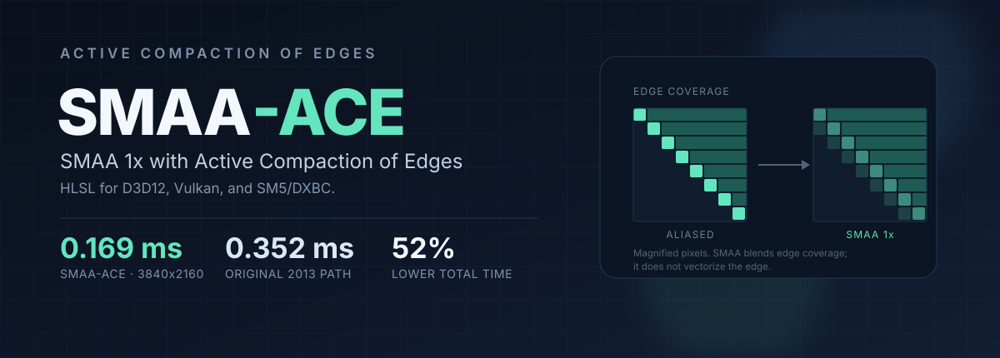
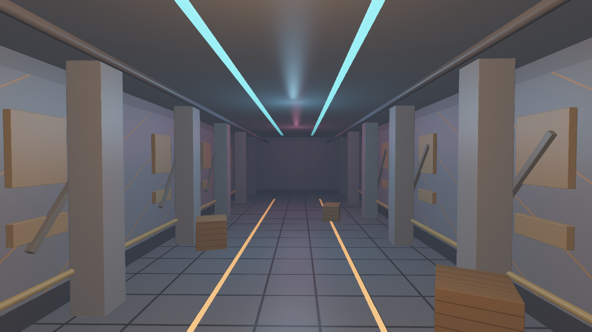
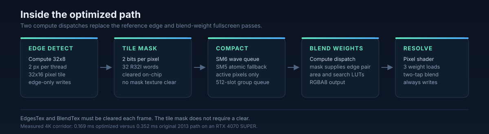

<p align="center">
  
</p>

# SMAA-ACE

**SMAA-ACE is SMAA 1x in HLSL for D3D12, Vulkan, and SM5/DXBC.** ACE stands for Active Compaction of Edges: the shader keeps the original MIT SMAA math and lookup textures and replaces the fullscreen edge and blend-weight passes with a compacted compute pipeline.

`D3D12` · `Vulkan` · `D3D11/SM5` · `HLSL` · `SMAA 1x` · `MIT`

## Shader targets

| Target | Status |
| --- | --- |
| D3D12 + SM6 | Default. Demo and benchmarks use this path. |
| Vulkan + SM6 | Compiles to SPIR-V. No Vulkan host is included. |
| Vulkan + SM5 | Compiles to SPIR-V with `SMAA_USE_SM6=0`. No runtime validation. |
| D3D11-class SM5/DXBC | Compiles with FXC. No DX11 host is included. |

DXC handles SM6 and SPIR-V; use FXC for SM5/DXBC. On devices without `R8G8_UNORM` typed UAV support, use an RGBA8 edge texture. See [docs/INTEGRATION.md](docs/INTEGRATION.md).

## Overview

The reference SMAA 1x pipeline runs edge detection and blend-weight calculation as fullscreen pixel passes, even though most pixels contain no edge. This implementation runs both stages in compute. Edge detection packs a 2-bit mask per 32x16 tile; edge pixels are compacted into a shared-memory queue so only those pixels execute the search, LUT sampling, and weight write.

On the demo corridor:

- **0.169 ms vs 0.352 ms** at 3840x2160, a **52% reduction**.
- **0.051 ms vs 0.222 ms** for blend weights at 4K, a **4.35x** speedup.
- **Maximum 1/255 difference** from the original path on the 3D scene, with flat regions unchanged.

Edge detection is roughly neutral. The savings come from skipping blend-weight work.

<p align="center">
  
</p>

## Optimizations

<p align="center">
  
</p>

| Optimization | What it does |
| --- | --- |
| **Compute edge and blend stages** | Replaces the reference fullscreen edge and blend-weight pixel passes with two compute dispatches, enabling thread-group cooperation and shared-memory queues. |
| **32x8 groups, two pixels per thread** | Covers a 32x16 pixel tile per group. |
| **2-bit tile mask** | Packs two edge bits per pixel into 32 `R32I` words per tile, about 0.25 bytes per pixel instead of a full-resolution RG8 edge mask. The mask is built in groupshared memory and written once per tile. |
| **On-chip mask clear** | The first 32 threads clear the groupshared mask words. No full-resolution mask texture is allocated or cleared. |
| **Active-pixel compaction** | Edge pixels are compacted into a 512-slot groupshared queue. Only queued pixels run the blend-weight search, LUT sampling, and weight write. |
| **SM6 wave compaction** | `WaveActiveCountBits`, one atomic per wave per batch, and `WavePrefixCountBits` produce the active list with minimal atomic traffic. |
| **SM5 fallback** | A per-active-pixel groupshared-atomic path for SM5/DXBC builds (`SMAA_USE_SM6=0`). Compile it with FXC for D3D11-class targets. |
| **Edge-only writes** | The edge compute shader writes `EdgesTex` only when an edge is present; it does not store zeros for inactive pixels. The host must still clear `EdgesTex` and `BlendTex` each frame because blend searches read neighboring texels. |
| **Mask supplies the blend edge pair** | The blend pass reads the 2-bit edge code from the tile mask instead of fetching `EdgesTex` per pixel. |
| **Direct integer loads** | Edge detection and the first diagonal search use exact integer `Load` operations instead of filtered samples. The second diagonal search intentionally remains bilinear because its quarter-pixel offset encodes crossing-edge information. |
| **Early exit after left/top** | Edge detection returns immediately when neither the left nor top delta exceeds the threshold, matching the reference discard without issuing the remaining color loads. |
| **Resolve integer loads** | Resolve fetches the three relevant blend weights with `Load` instead of filtered samples and uses the same two-tap neighborhood blend as the reference. |
| **Compile-time PSO specialization** | `SMAA_EDGE_MODE` and `SMAA_DEBUG_MODE` fold the runtime `Options.x`/`Options.y` branches. The demo compiles two edge and three resolve variants and selects the matching PSO. Most of the measured gain is in resolve. |
| **Separate low-contrast entry** | The optional low-contrast detector is a separate compute entry point. The demo only compiles it when enabled. |

### Where the time goes

4K, 3D corridor:

| Pass | Optimized | Original 2013 | Difference |
| --- | ---: | ---: | ---: |
| Edge detection | 0.058 ms | 0.059 ms | Neutral |
| Blend weights | 0.051 ms | 0.222 ms | 4.35x faster |
| Resolve | 0.060 ms | 0.069 ms | 1.15x faster |
| **Total** | **0.169 ms** | **0.352 ms** | **52% lower** |

The gain is content-dependent. The 2D high-frequency stress pattern has far more edges, so fewer pixels are skipped: at 4K the optimized path is 0.545 ms versus 0.858 ms, a 36.5% reduction. On that pattern the optimized edge pass is slightly slower than the reference edge pass (0.103 ms versus 0.090 ms), while the compacted blend pass still wins overall.

## Benchmarks

Measured on an NVIDIA RTX 4070 SUPER with GPU timestamp queries. Values are medians of 300-frame runs, three repeats, at the native output resolution, with the D3D12 debug layer disabled. The scene is drawn before timestamp 0, so the numbers cover the SMAA passes only. See [docs/PERFORMANCE.md](docs/PERFORMANCE.md) for the method and caveats.

### 3D corridor

| Resolution | Optimized | Original 2013 | Reduction |
| --- | ---: | ---: | ---: |
| 1920x1080 | 0.055 ms | 0.115 ms | 52.2% |
| 2560x1440 | 0.084 ms | 0.163 ms | 48.5% |
| 3840x2160 | 0.169 ms | 0.352 ms | 52.0% |

### 2D high-frequency stress test

Synthetic high-frequency pattern, included as a worst case. Its numbers are not comparable to the corridor.

| Resolution | Optimized | Original 2013 | Reduction |
| --- | ---: | ---: | ---: |
| 1920x1080 | 0.132 ms | 0.194 ms | 32.0% |
| 2560x1440 | 0.241 ms | 0.361 ms | 33.2% |
| 3840x2160 | 0.545 ms | 0.858 ms | 36.5% |

## Quality

Both paths use the SMAA ULTRA settings: 32 search steps, 16 diagonal steps, 25% corner rounding, and threshold 0.1. The optimized path is quality-equivalent to the reference path, but it is not bit-identical because the compute path changes evaluation order.

Deterministic 4K comparison, optimized mode 0 versus original 2013 mode 1:

| Scene | Max diff | MAE | > 1/255 | > 10/255 | Changed |
| --- | ---: | ---: | ---: | ---: | ---: |
| 3D corridor | 1/255 | 0.00000015 | 0.0000% | 0.0000% | 0.0087% |
| 2D stress | 2/255 | 0.00001701 | 0.0017% | 0.0000% | 0.7453% |

Flat regions are exact on the 3D scene.

### Low-contrast edge mode (opt-in)

`--low-contrast-edge` enables a separate edge detector for low-contrast jaggies. It combines a luma-adaptive threshold with CMAA-style local contrast suppression and an adjacent-extreme LCA term.

| Scene | Stock | Low-contrast | Original 2013 |
| --- | ---: | ---: | ---: |
| 1080p 3D | 0.055 ms | 0.078 ms | 0.115 ms |
| 1440p 3D | 0.084 ms | 0.123 ms | 0.163 ms |
| 4K 3D | 0.169 ms | 0.248 ms | 0.352 ms |
| 4K 2D stress | 0.545 ms | 0.620-0.641 ms | 0.858 ms |

The LCE mode is 21-32% faster than the original SMAA but 40-55% slower than the default SMAA-ACE optimized path in 3D.

Against 4x SSAA at 4K 3D, it lowers MAE from 0.00033556 to 0.00032792 and pixels above 10/255 from 0.2220% to 0.1965%, with flat regions unchanged. The tradeoff is a small reduction in high-frequency energy (slightly softer edges) and a small increase in pixels changed by just over 1/255. The thresholds were tuned on the procedural demo scenes; real-content results may vary. It is **off by default**.

## Install and build

No prebuilt binaries or NuGet package are distributed. Copy the `SMAA/` folder into your renderer, or build the demo to run the reference comparison and timing tests.

### Demo requirements

- Windows 10 or 11
- A D3D12-capable GPU and driver
- The .NET 8 SDK
- The DXC shader compiler is used at runtime through Vortice.Dxc; no separate shader build step is required for the demo

NuGet restores Vortice.Direct3D12, Vortice.DXGI, and Vortice.Dxc automatically.

From the repository root:

```powershell
dotnet build Demo/Demo.csproj -c Release
dotnet run --project Demo/Demo.csproj -c Release -- --width 1280 --height 720 --mode 0
```

The project copies the `SMAA/` folder, the reference shaders, and the demo shaders into the output directory, so the demo can be launched from any working directory.

### Quick launch scripts

| Script | Resolution |
| --- | --- |
| `Demo\run-720p.bat` | 1280x720 |
| `Demo\run-1080p.bat` | 1920x1080 |
| `Demo\run-1440p.bat` | 2560x1440 |
| `Demo\run-2160p.bat` | 3840x2160 |

Example: run 1440p for 300 frames with the debug layer disabled.

```powershell
.\Demo\run-1440p.bat --frames 300 --no-debug-layer
```

### Use in your renderer

The renderer owns resource creation, descriptors, barriers, clears, and presentation. The full resource contract is in [docs/INTEGRATION.md](docs/INTEGRATION.md).

The default build emits D3D12 register bindings. Define `SMAA_VULKAN=1` for Vulkan descriptor-set bindings, or compile with FXC plus `SMAA_USE_SM6=0` for the D3D11-class SM5 path.

Minimal integration checklist:

1. Copy the `SMAA/` folder into your shader pipeline.
2. Create a color input view, `EdgesTex` (RG8), `BlendTex` (RGBA8), and `EdgeMask` (`R32_SINT`). The area LUT is RG8 160x560; the search LUT is R8 64x16; neither is sRGB.
3. Compile `SMAAFullscreenVS`, `SMAAEdgeDetectionCS`, `SMAABlendWeightsCS`, and `SMAAResolvePS`. Compile `SMAAEdgeDetectionLowContrastCS` only if you enable the optional mode.
4. Dispatch edges with `ceil(width / 32)` by `ceil(height / 16)` groups, dispatch blend over the same tile grid, then draw the resolve fullscreen triangle.
5. Clear `EdgesTex` and `BlendTex` every frame. `EdgeMask` does not require a clear.
6. Insert UAV and resource barriers between edge, blend, and resolve, following the sample.

Example shader compilation with DXC (run from inside `SMAA/`):

```powershell
dxc -T vs_6_0 -E SMAAFullscreenVS SMAA.hlsl -Fo SMAAFullscreenVS.cso
dxc -T cs_6_0 -E SMAAEdgeDetectionCS -DSMAA_USE_SM6=1 SMAA.hlsl -Fo SMAAEdgeDetectionCS.cso
dxc -T cs_6_0 -E SMAABlendWeightsCS -DSMAA_USE_SM6=1 SMAA.hlsl -Fo SMAABlendWeightsCS.cso
dxc -T ps_6_0 -E SMAAResolvePS SMAA.hlsl -Fo SMAAResolvePS.cso
```

DXC does not compile Shader Model 5 profiles. For SM5/DXBC, use FXC with `SMAA_USE_SM6=0` for every entry point:

```bat
fxc /nologo /T vs_5_0 /E SMAAFullscreenVS /DSMAA_USE_SM6=0 /Fo SMAAFullscreenVS.cso SMAA.hlsl
fxc /nologo /T cs_5_0 /E SMAAEdgeDetectionCS /DSMAA_USE_SM6=0 /Fo SMAAEdgeDetectionCS.cso SMAA.hlsl
fxc /nologo /T cs_5_0 /E SMAABlendWeightsCS /DSMAA_USE_SM6=0 /Fo SMAABlendWeightsCS.cso SMAA.hlsl
fxc /nologo /T ps_5_0 /E SMAAResolvePS /DSMAA_USE_SM6=0 /Fo SMAAResolvePS.cso SMAA.hlsl
```

Add `SMAAEdgeDetectionLowContrastCS` with `cs_5_0` only if you enable the optional low-contrast mode. The SM5 path compiles, but this repository ships no D3D11 host or runtime validation.

For Vulkan SPIR-V, add `-spirv -DSMAA_VULKAN=1`. Both the SM6 wave path and the SM5 atomic fallback compile to SPIR-V with DXC. The Vulkan binding model and formats are documented in [docs/INTEGRATION.md](docs/INTEGRATION.md); no Vulkan host or runtime validation is included.

## Controls

| Key | Action |
| --- | --- |
| F1 or 1 | Optimized compute SMAA (mode 0, default) |
| F2 or 2 | Original 2013 SMAA (mode 1) |
| F3 or 3 | SMAA off (mode 2) |
| F4 | Toggle the 2D test pattern and the 3D corridor scene |
| F5 | Toggle edge visualization |
| F6 | Toggle blend-weight visualization |
| F12 | Save a screenshot |
| Space | Pause or resume the 3D scene animation (SMAA keeps running) |

## Command line

| Option | Description | Default |
| --- | --- | --- |
| `--width <px>` | Client width | 1920 |
| `--height <px>` | Client height | 1080 |
| `--mode <0-2>` | 0 = optimized, 1 = original 2013, 2 = off | 0 |
| `--aa <name>` | `optimized`, `original`, or `off` (same as `--mode`) | `optimized` |
| `--edge-mode <0-1>` | 0 = max-channel, 1 = luma weighted | 0 |
| `--low-contrast-edge` | Enable the optional low-contrast edge mode | off |
| `--scene <3d\|2d>` | 3d = raymarched corridor, 2d = test pattern | 3d |
| `--frames <n>` | Render `n` frames, then exit | unlimited |
| `--screenshot <path>` | Save a BMP screenshot (absolute or relative) | none |
| `--capture-frame <n>` | Frame number to capture | 30 |
| `--no-debug-layer` | Disable the D3D12 debug layer (benchmarking only) | flag off; debug layer enabled |

Example deterministic capture:

```powershell
dotnet run --project Demo/Demo.csproj -c Release -- --width 1280 --height 720 --mode 0 --frames 30 --screenshot .\capture.bmp --capture-frame 15
```

The window title reports the active scene, SMAA mode, edge mode, debug view, and `PAUSED` when the scene is paused. The 2D pattern is selected with `--scene 2d` or F4. Animation time is based on rendered scene frames, so captures and benchmark runs are deterministic.

Clean 4K benchmark:

```powershell
dotnet run --project Demo/Demo.csproj -c Release -- --width 3840 --height 2160 --mode 0 --frames 300 --no-debug-layer
```

## Repository layout

```text
.
├── SMAA/                     Drop-in shader folder
│   ├── SMAA.hlsl             Optimized SMAA shader library
│   ├── AreaTex.rg8           SMAA area LUT, 160x560 RG8
│   ├── SearchTex.r8          SMAA search LUT, 64x16 R8
│   └── LICENSE-SMAA.txt      MIT notice for the original SMAA authors
├── LICENSE                   MIT license for this project
├── README.md
├── .gitignore
├── Demo/
│   ├── Demo.csproj           D3D12 Vortice demo project
│   ├── Program.cs            Renderer, CLI, modes, timing, screenshots
│   ├── DemoScene.hlsl        Procedural raymarched 3D corridor
│   ├── DemoShaders.hlsl      Passthrough shaders for comparison modes
│   ├── run-720p.bat          Launch at 1280x720
│   ├── run-1080p.bat         Launch at 1920x1080
│   ├── run-1440p.bat         Launch at 2560x1440
│   ├── run-2160p.bat         Launch at 3840x2160
│   └── Reference/            Original 2013 SMAA, demo comparison only
│       ├── SMAA2013.hlsl     Original 2013 SMAA (MIT)
│       └── SMAAReference.hlsl D3D12 entry-point wrapper for the original
└── docs/
    ├── INTEGRATION.md        Resource contract and API integration notes
    ├── PERFORMANCE.md        Benchmark method, numbers, and caveats
    ├── hero.svg              Custom README banner
    ├── pipeline.svg          Optimized pipeline diagram
    └── screenshot.png        Demo capture
```

## Scope and limitations

- **SMAA 1x only.** There is no temporal SMAA, reprojection, depth/stencil predication, or MSAA resolve path.
- **Color-only edge detection.** The shader does not use depth, normals, or motion vectors.
- **Two LUTs are required.** The area and search textures are part of the original MIT SMAA distribution and are included in `SMAA/`.
- **Not bit-identical to the 2013 reference.** Compute evaluation order changes the last bit on a small number of pixels. The measured maximum is 1/255 on 3D and 2/255 on 2D; flat regions are exact.
- **Performance is content-dependent.** Sparse-edge scenes benefit most. Dense, high-frequency content sees a smaller gain.
- **R8G8 UAV support is not universal.** Some older devices do not support RG8 storage images; use an RGBA8 edge texture and adjust the image format as noted in [docs/INTEGRATION.md](docs/INTEGRATION.md).
- **The SM5/DXBC path has no bundled host.** All stock and low-contrast entry points compile with FXC to shader model 5, but this repository includes no D3D11 renderer, resource setup, or runtime validation for that path.
- **Vulkan compiles, but is not runtime-validated here.** The shader emits Vulkan bindings with `SMAA_VULKAN=1` and compiles to SPIR-V with both compaction paths. The bundled demo is D3D12-only, so Vulkan descriptors, barriers, and presentation are left to the host.
- **Low-contrast mode is tuned on procedural scenes.** Validate it on your own content before shipping it.

## References & Credits

- Jorge Jimenez, Jose I. Echevarria, Tiago Sousa, and Diego Gutierrez. "SMAA: Enhanced Subpixel Morphological Antialiasing." *Computer Graphics Forum*, 2012.
- Original SMAA project: <https://github.com/iryoku/smaa>
- PoisonLoca for creating the graphics for this repository 

## License

This project is released under the MIT License; see [LICENSE](LICENSE).

The SMAA algorithm, original shader code, area texture, and search texture are MIT-licensed by Jorge Jimenez, Jose I. Echevarria, Tiago Sousa, and Diego Gutierrez. The original notice is in [SMAA/LICENSE-SMAA.txt](SMAA/LICENSE-SMAA.txt).

This project is an independent implementation and is not affiliated with or endorsed by the original SMAA authors.
